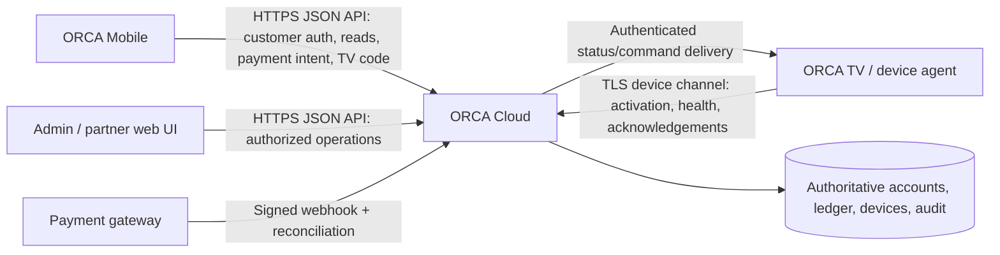

# ORCA appliance family — system architecture

**Status:** Current-state and target architecture, reviewed on 21 October 2026 on `codex/orca-cloud-foundation` at `3f5e4b8`. This document distinguishes observed code from the intended production design. It does not claim that production services, infrastructure, or integrations already exist.

## 1. Purpose and repository layout

This repository groups three ORCA projects so mobile, web/backend, and TV contributors can work in separate folders. A shared approved integration contract is a target; the current mobile API document is still a proposal.

```text
orca_mobile/   Flutter customer app demo; separate unselected duplicate Dart entrypoint exists
orca_webserver/ marketing pages + browser dashboard demo + Django Phase 1/2 foundation
orca_TVapp/    single browser-based TV simulator
```

The intended production family has one authoritative central service, ORCA Cloud, that coordinates customer accounts, appliances, finance records, payment-provider results, activation, and device status. The mobile and TV clients communicate with that service. They must not treat one another as authorities or connect directly to each other for account or payment decisions.

**Current-state warning:** A Django project, custom user, domain schema, local/fake adapters, migrations, state-transition helpers, health/readiness routes, and a Render Blueprint draft are now present under `orca_webserver/`. The server has no customer/staff product API, implemented authentication flow, live provider integration, or production deployment proof. Production hostnames, actual Render/Supabase services, hardware/device protocol, and approved account/finance semantics remain **UNVERIFIED**. The current branch is not production-ready.

## 2. Component responsibilities

### Verified component inventory (21 October 2026)

| Component | Current implementation | Entry point | Data source | External integrations | Tests and observed result | Production status | Next dependency |
|---|---|---|---|---|---|---|---|
| ORCA Mobile (`orca_mobile/`) | Flutter UI with Home, Pay, Device, History, Link TV and intro; actions and account/device values are demo. | Default `flutter run` entrypoint `lib/main.dart`; a different `orca_mobile/main.dart` is unselected. | In-memory `AppState` sample values and transaction list; no API or durable app storage observed. | Flutter `video_player` plugin for the intro asset. No payment/API provider package configured. | `test/widget_test.dart` has two widget tests. Flutter SDK was unavailable in Mission 02; result **UNVERIFIED**. | **PROTOTYPE / DEMO** | Install compatible Flutter SDK, run tests, approve identity and API contract, implement isolated typed repository. |
| ORCA Web/Cloud (`orca_webserver/`) | Two marketing pages, browser-only staff dashboard demo, Django custom user/domain schema/transitions/local adapters and health checks. | Static pages `index.html`, `indexb.html`, `orca-dashboard-demo-1.html`; Django `manage.py` / `config.wsgi:application`. | Marketing HTML is static. Dashboard generates sample data and stores only theme in `localStorage`. Django ORM selects configured DB; test settings use SQLite, production URL configuration is not evidence of live data. | Google Fonts from HTML; local/fake adapters in Django. No live payment/SMS/storage/device provider connection observed. | `apps/accounts/tests.py`, `apps/domain/tests.py`. Earlier Phase 2 report: 40 passed, 4 PostgreSQL-only skips in a temporary Pillow-enabled environment. Mission 02 rerun failed during test import because shared venv lacked Pillow; see `docs/testing.md`. | **IMPLEMENTED FOUNDATION**; demos are separate; not production-ready. | Install declared dependencies reproducibly, run PostgreSQL tests, close security/product decisions, approve and implement APIs/auth, prove hosting/backups. |
| ORCA TV (`orca_TVapp/`) | Single-screen-sized HTML/JS simulator for boot, network, activation, linked, payment, home/restricted and reset states. | `orca-tv-demo-1.html`. | In-memory JavaScript state reset on page reload. | Google Fonts in the browser. No hardware/network service observed. | No test folder or automated test command found. Browser run not performed; **UNVERIFIED**. | **PROTOTYPE / DEMO** | Select target TV hardware/runtime, secure device provisioning and protocol; create device/browser test plan. |

The inventory describes this branch at its recorded review point. A file's presence or a configuration value does not prove that the corresponding build, service, account, or integration is operational.

### ORCA Mobile — `orca_mobile/`

- Give an authenticated customer a customer-scoped view of their profile, appliance, balance, due date, payment history, and TV-link state.
- Collect a payment request or six-digit TV-link code and send the customer's intent to ORCA Cloud.
- Display financial, payment, appliance, and link states returned by ORCA Cloud. Never calculate or declare authoritative balances, payment confirmation, eligibility, or restriction state.
- Keep demo data visibly separate from live data. A network failure must never silently switch a real customer into demo data.
- Own presentation, accessibility, localization, input assistance, and safe transient draft handling. The backend remains responsible for validation and authorization.

**Observed implementation:** `orca_mobile/lib/main.dart` is Flutter's default package entry point when running from `orca_mobile/`; `pubspec.yaml` does not define a custom entrypoint. It uses in-memory `AppState`, seeded sample amounts, sample transactions, and explicit demo messages. `video_player` is the notable runtime package beyond Flutter. There are no HTTP, WebSocket, or persistent-data API packages configured in `pubspec.yaml`. `orca_mobile/docs/api-contract.md` is explicitly a **draft proposal**, not a deployed API contract. `orca_mobile/orca_mobile/main.dart` is a second, different copy of app code; which copy is intended for future work is **UNVERIFIED**. Do not assume the duplicate is equivalent or selected.

### ORCA Cloud / central service — intended role of `orca_webserver/`

The production service should be the single authority and integration boundary for:

- Customer authentication, sessions, profile, consent, and object-level authorization.
- Customer-to-appliance ownership and device registration.
- Financing agreements, payment schedule, authoritative ledger, payment intents, provider callbacks, reversals, and reconciliation.
- TV activation-code issuance/validation, one-time use, expiry, linking, and link status.
- Authoritative appliance status and approved device commands; device telemetry and command acknowledgements.
- Administrative roles, audit events, support workflows, and operational health.
- Versioned APIs consumed by mobile, TV, and authorized web dashboards.

The service must make every financial or device-state transition transactionally and auditably. Payment confirmation must follow a verified payment-provider callback or reconciliation result, never a client assertion. TV restrictions and reactivation must follow approved contract and policy rules enforced server-side.

**Observed implementation:** `orca_webserver/` contains two marketing-page variants (`index.html`, `indexb.html`), the browser dashboard demo (`orca-dashboard-demo-1.html`), media assets, and a Django project. The marketing pages have no forms or API requests. The dashboard creates sample records in JavaScript; `localStorage` is used for the theme preference, not business records. The Django code has a custom user, Phase 2 domain models/migrations, transition services, health/readiness routes and local/fake adapters. `config/urls.py` registers `/healthz`, `/readyz`, and Django `/admin/`; it does not register the proposed `/api/v1/` product endpoints. No live provider connection or deployed service was verified. See `orca_webserver/docs/PHASE2_REPORT.md` and `docs/AI_REVIEW_TRACE.md`.

### ORCA TV — `orca_TVapp/`

- Show a simple TV-native state: standby, startup/connectivity, activation, linked, active/restricted, and network recovery.
- Identify itself to ORCA Cloud using a provisioned device identity; request or display a short-lived activation code only after the service approves it.
- Receive authoritative link and appliance-status updates from ORCA Cloud. Report connectivity and minimal device health/command acknowledgements.
- Display clear recovery instructions without exposing customer account details or payment credentials.
- Never accept payment, mark a payment confirmed, calculate arrears, or make an independent restriction decision.

**Observed implementation:** The only TV project source is `orca_TVapp/orca-tv-demo-1.html`. It is a large-screen HTML/JavaScript simulator with in-memory state and developer controls for power, Wi-Fi, activation, payment, restricted state, and reset. The activation code is local demo state; pressing controls directly changes state. There is no hardware API, device identity, server request, broker connection, persistence, or real TV control. The final TV operating system, hardware/embedded-agent design, secure provisioning, and connectivity protocol are **UNVERIFIED**.

## 3. Authority and ownership rules

| Data or decision | Authority in production | Mobile responsibility | TV responsibility | Web dashboard responsibility |
|---|---|---|---|---|
| Customer identity/session | ORCA Cloud identity service | Authenticate and hold session securely | No customer login; use device identity | Authenticate staff and enforce staff role |
| Customer owns appliance | ORCA Cloud records | Display only authorized appliances | Identify itself by provisioned device ID | Show authorized records to staff |
| Amount due, amount paid, due dates | Financing ledger in ORCA Cloud | Format integer amounts and show freshness | Do not calculate or display personal finance data | Show server-provided finance summaries |
| Payment state | ORCA Cloud after verified provider result | Start intent, display pending/confirmed/failed states | Receive only approved resulting appliance state | Reconcile and support payments; never fabricate provider confirmation |
| Activation/link state | ORCA Cloud | Submit code and poll/read link result | Request/display code and wait for server link confirmation | Support/admin tools use authorized APIs |
| Active/restricted state | ORCA Cloud policy + device acknowledgement | Read-only display | Apply only authenticated server-authorized command; report acknowledgement | View/audit; do not bypass policy |
| UI language and layout | Each client | Own local user experience | Own TV-readable presentation | Own web experience |

Use stable server IDs, timestamps, explicit enums, and `request_id` across interfaces. Do not use display names, phone numbers, or activation codes as object identity.

## 4. Intended communication topology

The diagram below is the **target** topology, not a picture of current network traffic. At the reviewed commit the Flutter and HTML clients do not call the Django project. `config/urls.py` exposes only health/readiness and Django admin routes; no product API exists.



- Mobile talks to the central API over HTTPS. Mobile does not call the TV directly, expose backend database credentials, or decide that a payment succeeded.
- TV talks to the central service through a device-specific authenticated channel. HTTPS polling, WebSocket, or MQTT over TLS may be suitable, depending on device/firmware constraints. The protocol is **UNVERIFIED** and must be selected by the backend and hardware owners.
- Payment providers call a public, narrowly scoped webhook endpoint. Verify signatures, event age, replay protection, provider reference, amount, and currency before changing the ledger.
- Staff/admin browser actions call role-protected service APIs. The browser is not trusted to enforce authorization.
- The database is reachable only by the service. Mobile, TV, and static pages never connect to it directly.
- The public marketing website can remain static and separately hosted. If it becomes an admin/customer application, it must use the same documented API and authorization boundaries.

## 5. Target production flows (not implemented)

### Customer payment

1. Mobile fetches the signed-in customer's authoritative account summary and current payment methods.
2. Customer confirms an amount and method. Mobile creates one idempotency key for that attempt and submits a payment intent with the authenticated session.
3. Cloud validates ownership, amount, method, limits, and current account state; stores the intent before contacting the provider.
4. Provider processes payment and sends a signed callback. Cloud verifies and reconciles it, updates the ledger transactionally, and records an audit event.
5. Mobile reads payment status and refreshes balance/history only when Cloud reports the resulting authoritative status.
6. If the agreement's approved policy changes device entitlement, Cloud sends a versioned command/status to the TV device channel. The TV acknowledges application; Cloud records the acknowledgement and reports actual state separately from desired state.

A timeout after intent creation is an unknown/pending outcome, not a failed payment and not permission to start a second charge. Retry with the same idempotency key or read the original payment resource.

### TV activation/link

1. TV obtains its device identity from secure provisioning and requests an activation code from Cloud.
2. Cloud creates a short-lived, rate-limited, single-use code scoped to the intended device/session. Do not expose device credentials in the code.
3. Customer signs in to mobile, selects the appliance/account as applicable, and submits the code to Cloud.
4. Cloud verifies code, customer permissions, expiry, attempts, and existing link constraints, then links records transactionally.
5. Mobile reads the link result; TV receives the result through its authenticated device channel. Both show linked only after Cloud confirms it.
6. Cloud expires unused codes and records minimal audit metadata. Never log the raw code.

The code length, issuance route, expiry, rate limits, device/customer relationship, and whether codes are QR or numeric are **UNVERIFIED**. `api-contract.md` proposes a six-digit customer-entered code; approve the real device-side contract before implementing either end.

### Device status and command handling

- Cloud stores the authoritative desired state and the last reported observed state separately.
- Every command has a unique ID, device ID, creation/expiry time, policy/version reference, and idempotent application rule.
- TV acknowledges accepted/applied/rejected/expired outcomes. Cloud must not report a command as physically applied without the acknowledgement or an explicit uncertainty state.
- On reconnect, TV fetches current desired state and reports a sequence/version so stale commands cannot roll state backward.
- A device channel outage must show `unknown` or stale status; it must not be mistaken for `active` or `restricted`.
- Restriction rules, grace periods, overrides, appeal/recovery, and legal notice are product/legal decisions and are **UNVERIFIED**. Do not implement these decisions from demo toggles.

## 6. API and event contract

`orca_mobile/docs/api-contract.md` is the current detailed API proposal. It proposes `/api/v1/` JSON endpoints for `/me`, account summary, appliances, payment methods, payments, and TV links. It is not approved or implemented in this repo.

Before production integration:

1. Backend, mobile, TV/firmware, finance, payments, security, and support owners approve one OpenAPI schema and publish its version.
2. Define authentication, token lifecycle, device certificate/key provisioning and rotation, staff roles, rate limits, error codes, idempotency scope/retention, pagination, timestamps, amounts, enums, and freshness guarantees.
3. Generate or validate client models from the agreed schema. Do not independently invent endpoint names or fields in a client.
4. Keep customer JSON APIs and device-command protocol separately authorized, even if one service implements both.
5. Provide contract tests or sandbox fixtures for every client. No production credentials or secrets go in this repository or a mobile/TV binary.
6. Use additive compatible changes first. If a breaking API/device-protocol change is required, coordinate server support, client release minimum versions, rollout, and rollback before removing old behavior.

Proposed API contract requirements already captured in the mobile draft include integer TZS values, authenticated customer scoping, server-authoritative financial/device decisions, idempotent payment and TV-link submissions, privacy-safe errors, and redaction of tokens/codes/financial personal data.

## 7. Offline, freshness, and retry behavior

- Mobile may cache approved read-only summaries for display, but label last-updated time and stale state. Do not queue or replay payment intents with a new idempotency key.
- A payment intent can remain pending when the phone loses connectivity. Reconcile by reading the same server payment ID/idempotency result after reconnect.
- TV reconnect logic must use bounded exponential backoff with jitter, secure time handling, and a safe last-known screen. It must not invent a fresh link or apply expired commands.
- Cloud should accept duplicate provider callbacks and device acknowledgements idempotently; record a single business transition while retaining safe delivery metadata.
- Avoid tight polling loops. Set refresh frequency and server load limits with backend operations. Push channels should have a polling fallback when supported.
- Show `unknown`, `pending`, `stale`, or a recoverable error distinctly from confirmed states.

## 8. Security, privacy, and operational boundaries

- Require TLS in staging and production. Never ship server secrets, payment provider secrets, signing keys, or database credentials in mobile/TV builds or HTML.
- Enforce customer object authorization at every API request. Ignore client-supplied owner IDs for access decisions.
- Use scoped, revocable mobile sessions; device credentials distinct from customer tokens; rotate/revoke device keys on repair, resale, or compromise.
- Keep logs free of passwords, bearer tokens, raw activation codes, payment credentials, and unnecessary personal or financial values. Correlate with request/event IDs.
- Validate payment provider callback signatures, timestamps, amount, currency, merchant account, event ID, and replay status.
- Rate-limit sign-in, code issue/entry, payment initiation, device enrollment, and sensitive admin actions.
- Define data retention, customer consent, support access, incident ownership, backups, restore drills, alerting, and regional/legal requirements before live launch. These operational controls are **UNVERIFIED** in this repo.
- Restriction/remote-control behavior needs approved customer contract, consumer-protection review, human support and safe recovery. Do not infer authorization from a payment screen or dashboard sample.

## 9. Team ownership and change coordination

| Work area | Primary folder | Must coordinate with |
|---|---|---|
| Customer screens, app state, localization, mobile secure storage | `orca_mobile/` | API/backend for every server field and transition; payment owner for provider flow; TV owner for linking UX |
| Django foundation, future customer/staff API, database, ledger, authentication, web/admin UI, audit and gateway boundary | `orca_webserver/` | Mobile and TV clients; finance, gateway, device/security, operations |
| TV interface, device provisioning, connection, command acknowledgement | `orca_TVapp/` (future TV project) | Backend/device protocol; mobile activation UX; hardware and customer-support owners |
| Shared API/device schemas and architecture | Root docs and approved OpenAPI package (not present yet) | All three teams |

For each change, the owner must state which client/server versions it affects, API/device-contract version, data migration, security/privacy implications, rollback path, and how mixed old/new client versions behave. Keep project-specific build/test instructions in each folder's README. Do not deploy one family's components independently if the contract requires an incompatible paired release.

## 10. Integration gates before production

- [ ] Keep the observed Django foundation in `orca_webserver/`; verify service ownership, Render project/domain, Supabase project/database, environment separation, and connectivity. Source configuration exists; hosted resources and operation are **UNVERIFIED**.
- [ ] Approve customer/staff/device authentication and key lifecycle.
- [ ] Approve financing ledger, amounts, statuses, payment provider, reconciliation, refunds/reversals, and webhook behavior.
- [ ] Approve activation code/device provisioning, expiry, limits, and TV protocol.
- [ ] Publish versioned OpenAPI and device protocol with server and client contract tests.
- [ ] Replace all mobile sample data/actions with an explicit demo/live repository boundary; fail closed in live mode.
- [ ] Replace TV simulator developer controls with the approved TV platform/device agent; never package demo controls into production firmware.
- [ ] Complete backend APIs and authorization, then show PostgreSQL migration/concurrency, audit, backup/restore, monitoring, and recovery evidence. Models/services exist, but customer workflows and production operations do not.
- [ ] Validate installation, payment, link, offline/reconnect, device status, revocation, support, and rollback journeys using synthetic/staging accounts.
- [ ] Run security, privacy, legal, accessibility, and production-readiness review before opening real customer traffic.

## 11. Source files and references

- [Mobile project guide](orca_mobile/README.md)
- [Mobile API contract proposal](orca_mobile/docs/api-contract.md)
- [Mobile server-data migration guide](orca_mobile/docs/server-data-migration.md)
- [Web/server folder guide](orca_webserver/README.md)
- [TV project guide](orca_TVapp/README.md)
- [Mobile developer missions](orca_mobile/orca_mobile/ORCA_MOBILE_AI_MISSIONS.md)
